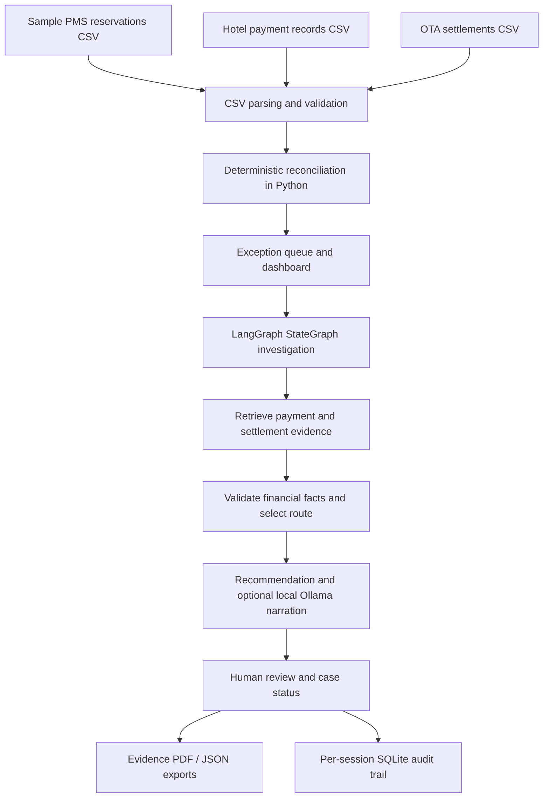

<div align="center">

# 🏨 HotelCase AI

### Hotel Revenue Reconciliation & Dispute Investigation — Interactive MVP

**A transparent, human-in-the-loop workflow for identifying hotel payment exceptions, investigating supporting records, and preparing review-ready evidence.**

[](https://hotelcase-ai-demo.streamlit.app/) [](https://www.python.org/) [](https://github.com/langchain-ai/langgraph) [](#testing)

**[🚀 Try the interactive demo](https://hotelcase-ai-demo.streamlit.app/)** · **[📂 Explore the source code](https://github.com/P-2-r-0-i-1-y-8-a/hotelcase-ai)**

*Built with synthetic hotel data for educational and portfolio demonstration. No real OTA submissions or payment collection.*

</div>

---

## The problem

Hotels handle reservation and payment information across multiple sources: the property management system (PMS), online travel agencies (OTAs), and payment or settlement records. When these disagree, teams must manually determine whether an amount is genuinely missing, still pending, already refunded, subject to a policy review, or duplicated in the data.

**HotelCase AI** demonstrates an evidence-first approach: reconcile the numbers in code, route exceptions through a LangGraph workflow, generate an explainable recommendation, and let a human review the case before any external action.

## What you can do in the demo

| Capability | What the visitor can try |
| --- | --- |
| 📊 Revenue overview | Explore property-level metrics, category distributions and **unverified** potential shortfalls. |
| 📁 CSV data lab | Download sample **reservations**, **payments**, and **settlements** CSVs; edit synthetic records and upload replacements to see reconciliation update. |
| 🚩 Exception queue | Filter and export cases such as shortfalls, pending settlements, overcollection, duplicate IDs and policy reviews. |
| 🧠 LangGraph investigation | Select a reservation, run a multi-step investigation, inspect retrieved records and deterministic checks, and see a proposed next step. |
| 🧾 Evidence packet | Download a case-specific PDF and machine-readable investigation JSON. |
| ✅ Human review | Change the case review state, add a note and inspect recorded audit events. **No dispute is submitted.** |
| 🔒 Temporary demo workspace | Each browser session has a separate temporary SQLite review database and a reset control. |

**Try it:** [hotelcase-ai-demo.streamlit.app](https://hotelcase-ai-demo.streamlit.app/)

> **Public-demo rules:** Use the bundled fictional CSVs only. Do **not** upload real guest information, card numbers, CVVs, confidential folios, or live hotel records. Each uploaded CSV is limited to 2 MB. The public demo does not authenticate users and is not a secure production data-processing service.

## Guided walkthrough: investigate HC-1001

1. Open the **Overview** tab and inspect the initial synthetic metrics.
2. Go to **Exceptions & Cases** to review the exception queue.
3. Open **LangGraph Investigation**, select **`HC-1001`**, then click **Run LangGraph investigation**.
4. Examine the financial checks, source rows, recommended next step and workflow route.
5. Download the **evidence PDF**, then open **Audit Trail** to review events.
6. Try **Reset my demo workspace** in the sidebar to return to a new, session-specific review history.

### Example: an unverified payment shortfall

| Synthetic case | Amount |
| --- | ---: |
| PMS-derived expected collection | $320.00 |
| Captured payment records | $220.00 |
| **Difference requiring verification** | **$100.00** |

The system **does not assume the $100 is recoverable**. It recommends checking settlement timing, refunds, adjustments, and source records before opening a recovery case.

Other bundled examples include reconciled OTA net settlements, pending payments, no-show/cancellation policy reviews, overcollection, and duplicate transaction identifiers.

## Architecture



### Why the architecture is designed this way

- **Financial calculations are deterministic.** Reconciliation uses Python integer-cent arithmetic, not LLM-generated balances.
- **LangGraph coordinates investigation stages.** The implemented graph retrieves records, validates facts, branches between review and clear outcomes, and produces an explanation. This is a **predefined workflow**, not an autonomous tool-selecting agent.
- **Optional local LLM narration.** Ollama (`llama3.2:3b`) can summarize the fixed investigation outcome when running locally. The public deployment does **not** depend on Ollama and does not offer general-purpose chat.
- **Human-in-the-loop review.** Case approval only marks a record as approved for **manual submission preparation**. The demo never contacts an OTA, processor, or bank.
- **Session separation.** A temporary SQLite database path is generated per Streamlit browser session; uploaded CSV content is held in that session's Streamlit widgets. Data are not durable and can disappear on reset or hosting restart.

## Technology stack

| Layer | Technology |
| --- | --- |
| Interactive application | Streamlit |
| Financial data processing | Python, pandas |
| Agent workflow | LangGraph `StateGraph` |
| Local LLM (optional) | Ollama, Llama 3.2 3B |
| Session-specific case and audit storage | SQLite |
| Evidence report generation | ReportLab (PDF), CSV, JSON |
| Automated testing | pytest |
| Public hosting | Streamlit Community Cloud, GitHub |

## Run locally

The application files currently live inside the **`HotelCase_AI_MVP/`** directory in this repository. Clone the repo and enter that directory before installing dependencies.

```powershell
# Windows PowerShell
 git clone https://github.com/P-2-r-0-i-1-y-8-a/hotelcase-ai.git
 cd hotelcase-ai\HotelCase_AI_MVP
 py -m venv .venv
 .\.venv\Scripts\Activate.ps1
 python -m pip install -r requirements.txt
 python -m streamlit run app.py --server.port 8508
```

Open **http://localhost:8508**. On later runs, activate the existing `.venv` and start Streamlit again; you do not need to reinstall packages.

macOS/Linux:

```bash
git clone https://github.com/P-2-r-0-i-1-y-8-a/hotelcase-ai.git
cd hotelcase-ai/HotelCase_AI_MVP
python3 -m venv .venv
source .venv/bin/activate
python -m pip install -r requirements.txt
python -m streamlit run app.py --server.port 8508
```

**Optional, local-only narration:** Install Ollama, pull `llama3.2:3b`, ensure Ollama is running, and enable **Optional local Ollama narration** in the sidebar. If Ollama is unavailable, deterministic LangGraph investigations still run.

## CSV data contracts

You can start from the three bundled files in `HotelCase_AI_MVP/data/`:

| File | Required columns |
| --- | --- |
| `reservations.csv` | `reservation_id`, `property_id`, `channel`, `payment_responsibility`, `booking_status`, `gross_amount`, `approved_refund`, `adjustment`, `ota_commission`, `currency`, `response_deadline` |
| `payments.csv` | `payment_id`, `reservation_id`, `amount`, `status`, `currency`, `processed_at` |
| `settlements.csv` | `settlement_id`, `reservation_id`, `amount`, `status`, `currency`, `settled_at` |

`CAPTURED` payments and `SETTLED` OTA transfers count as received; pending or voided entries do not. Duplicate transaction IDs are flagged and excluded from totals pending investigation. The prototype uses a simplified **USD-only** accounting model; all monetary exceptions require source verification.

## Testing

From inside `HotelCase_AI_MVP/`:

```bash
python -m pytest -q
```

**Latest reported local run (November 16, 2026): `17 passed in 4.23s`.** This is a developer-run result, not a continuous-integration guarantee. Tests cover reconciliation, financial-data edge cases, case review/audit behavior, PDF evidence, graph routing and separate temporary session databases.

For a basic public smoke test: open the live app in **normal and incognito** browser windows; run an investigation in one window; verify its new audit event does **not** appear in the other. Initial synthetic source records will be identical, which is expected.

## Repository map

```text
hotelcase-ai/
├── README.md                    # GitHub landing page (this document)
└── HotelCase_AI_MVP/
    ├── app.py                   # Streamlit interface
    ├── requirements.txt
    ├── hotelcase/
    │   ├── agent.py             # LangGraph investigation
    │   ├── reconciliation.py    # Deterministic financial rules
    │   ├── storage.py           # Session database and audit
    │   ├── evidence.py          # PDF evidence packet
    │   └── sample_data.py
    ├── data/                     # Synthetic CSV examples
    └── tests/                    # pytest suite
```

## Deploy on Streamlit Community Cloud

Use **Deploy a public app from GitHub** with:

| Setting | Value |
| --- | --- |
| Repository | `P-2-r-0-i-1-y-8-a/hotelcase-ai` |
| Branch | `main` |
| Main file path | `HotelCase_AI_MVP/app.py` |

The existing public deployment is at **https://hotelcase-ai-demo.streamlit.app/**. Changes pushed to the configured GitHub branch can trigger a Streamlit redeployment.

## Limitations and responsible use

This is a **synthetic-data MVP**, not an enterprise-ready hotel accounting system.

- No live SkyTouch, Booking.com, Expedia, payment-processor, or bank integrations.
- No automatic chargebacks, disputes, payouts, refunds, payment collection, or submission to external parties.
- No authenticated reviewer identities, tenancy controls, permanent secure storage, or production-grade audit immutability.
- Session separation is a demo safeguard, **not a substitute for user authentication, authorization or security review**.
- Uploaded records and case history are temporary; users should never provide real hotel or personal financial records.
- A discrepancy does not establish legal entitlement, missing revenue, or a guaranteed recovery amount.
- Response deadlines in demo data are supplied inputs; they are **not** verified against provider policies or law.

Future work could include authenticated multi-property accounts, validated PMS/OTA imports, secure document ingestion, exception evidence provenance, policy-aware deadlines, agent evaluation, approved submission workflows, and production-grade logging.

---

<div align="center">

**HotelCase AI** · Built as a hands-on demonstration of practical AI workflow orchestration, financial reconciliation, and accountable human review.

[Try the demo](https://hotelcase-ai-demo.streamlit.app/) · [View the source](https://github.com/P-2-r-0-i-1-y-8-a/hotelcase-ai)

</div>